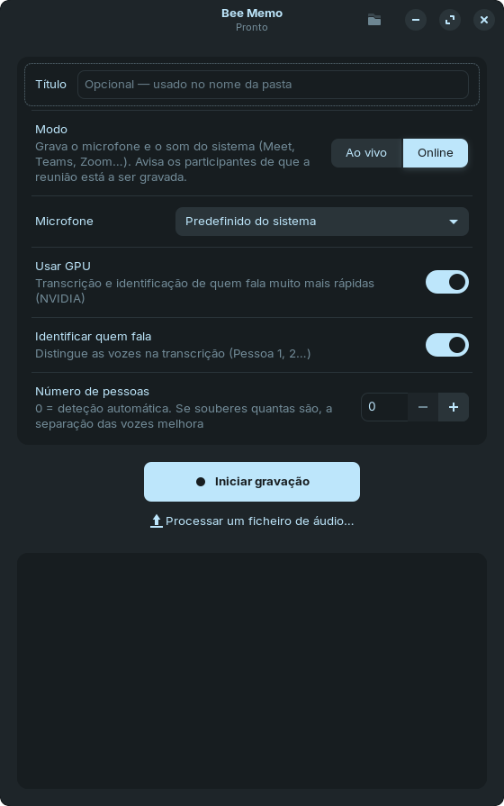
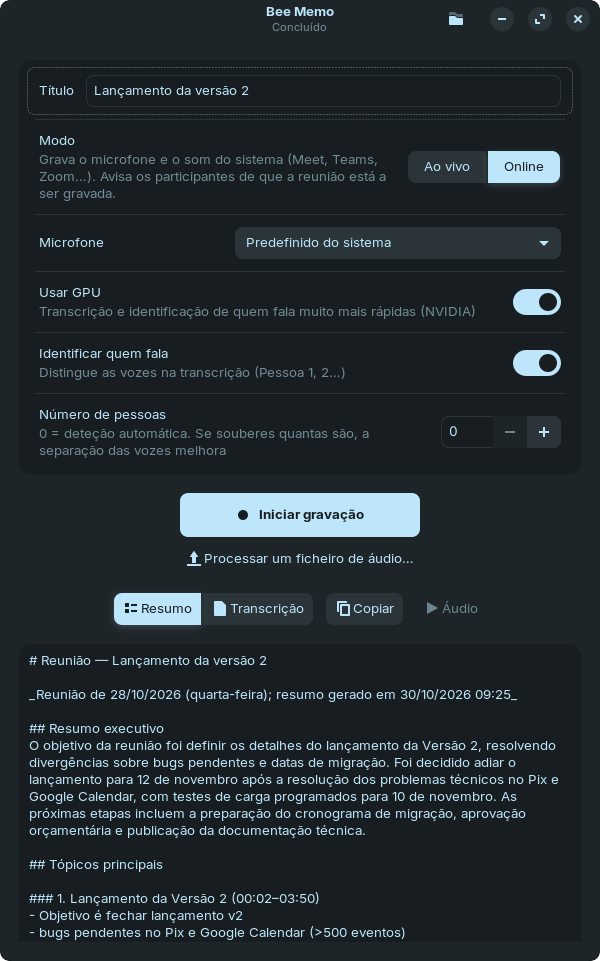

<div align="center">

# 🐝 Bee Memo

**A ata da sua reunião pronta minutos depois de ela acabar — sem que o áudio saia do seu computador.**

Grave uma reunião presencial ou online, ou largue uma mensagem de voz do WhatsApp, e receba a
transcrição com **quem disse o quê**, as **decisões**, as **tarefas com responsável e prazo** e
as **questões em aberto**.


-76b900)

</div>

<table>
  <tr>
    <td width="50%" align="center"></td>
    <td width="50%" align="center"></td>
  </tr>
  <tr>
    <td align="center"><sub>Escolha o modo e carregue em <b>Iniciar gravação</b></sub></td>
    <td align="center"><sub>No fim, o resumo aparece na própria janela</sub></td>
  </tr>
</table>

## Porquê o Bee Memo?

- 🔒 **Privacidade total.** Transcrição, identificação de vozes e resumo correm no seu
  computador. Nada é enviado para servidores de terceiros — ideal para reuniões com clientes,
  RH, saúde ou jurídico.
- 💸 **Sem assinaturas.** Sem planos, sem limite de minutos, sem conta para criar. Usa só
  ferramentas e modelos abertos e gratuitos: Whisper, sherpa-onnx e Ollama.
- 🤝 **Não entra na reunião.** Nada de bots a pedir para participar: grava o som do seu
  computador e funciona com Meet, Teams, Zoom, Discord ou qualquer outra aplicação.
- 👥 **Sabe quem disse o quê.** Separa as vozes (Pessoa 1, 2, 3…) e usa isso no resumo para
  dizer quem decidiu e quem ficou com cada tarefa.
- ✅ **Uma ata que se usa.** Resumo executivo, tópicos ordenados por importância com o
  momento da reunião, decisões, tarefas em checklist e o que ficou por responder.
- ⚡ **Rápida.** Com uma GPU NVIDIA, uma hora de reunião é transcrita em 2 a 4 minutos.
- 📱 **Também para áudios.** Mensagens de voz do WhatsApp, `.mp3`, `.m4a` e até vídeos:
  basta arrastá-los para a janela.

## Como funciona

```
 🎙️ Gravar  ─────▶  📝 Transcrever  ─────▶  👥 Quem fala  ─────▶  🤖 Resumir
 microfone e       Whisper large-v3-turbo   vozes separadas      decisões, tarefas,
 som do sistema    em português             por pessoa           tópicos e prazos
```

Um exemplo real, gerado pela app a partir de uma reunião fictícia de 4 minutos:

```markdown
## Tarefas
- [ ] Preparar calendário das fases — Pessoa 2 — sexta-feira
- [ ] Enviar rascunho do email e vídeo para revisão — Pessoa 3 — segunda-feira
- [ ] Levar proposta de orçamento à reunião de direção — Pessoa 1 — quinta-feira
- [ ] Falar com responsável de vendas — Pessoa 1 — hoje à tarde

## Questões em aberto
- Preço atual ou aumento na versão 2.
```

As tarefas só levam responsável e prazo quando foram ditos na reunião: a app filtra os prazos
que o modelo inventa.

## Tecnologia

| Etapa       | Ferramenta                                                     |
|-------------|----------------------------------------------------------------|
| Gravação    | `sounddevice` + PulseAudio (microfone e, no modo online, o som do sistema) |
| Conversão   | `ffmpeg` (para ficheiros: opus, mp3, wav, m4a, vídeo…)        |
| Transcrição | `faster-whisper`, modelo `large-v3-turbo` na GPU              |
| Quem fala   | `sherpa-onnx` (segmentação pyannote + vozes WeSpeaker), na GPU ou no CPU, em paralelo com a transcrição |
| Resumo      | Ollama (em Docker) com o modelo `qwen3.5:4b`                    |
| Interface   | GTK 3 (segue o tema do sistema)                               |

## Instalação (uma vez)

Requer Ubuntu, Zorin OS ou Debian, e o Docker instalado e acessível sem `sudo`
(utilizador no grupo `docker`). Com GPU NVIDIA, o Python do sistema tem de ser o 3.10
(Ubuntu 22.04, Zorin OS 17): a versão CUDA do `sherpa-onnx` que o instalador usa só existe
para essa versão.

```bash
cd meet-ai
chmod +x instalar.sh
./instalar.sh
```

O instalador:

- instala os pacotes do sistema (`ffmpeg`, PortAudio, GTK para Python);
- cria o ambiente Python em `.venv`;
- com GPU NVIDIA, instala as bibliotecas CUDA, a versão CUDA do `sherpa-onnx` (identificação
  de quem fala na GPU) e o `nvidia-container-toolkit`, para o Ollama usar a GPU dentro do Docker;
- arranca o Ollama no contentor `reuniao-ollama` e descarrega o modelo `qwen3.5:4b`;
- cria o comando `reuniao` em `~/.local/bin` e o atalho **Bee Memo** no menu de aplicações.

Na primeira transcrição, o modelo Whisper (~1,6 GB) é descarregado automaticamente, e na
primeira identificação de oradores os modelos do sherpa-onnx (~33 MB, para
`~/.cache/reuniao/modelos`).

## Interface gráfica

```bash
reuniao            # ou "Bee Memo" no menu de aplicações
```

### Gravar uma reunião

1. Escreva um **título** (opcional, é usado no nome da pasta).
2. Escolha o **modo**:
   - **Ao vivo** — grava só o microfone. Para reuniões presenciais.
   - **Online** — grava o microfone e o som do sistema, ou seja, os outros participantes.
     Entre na reunião no browser como habitualmente; ver [Reuniões online](#reuniões-online).
3. Escolha o **microfone** (aparecem com os mesmos nomes das Definições de som) e se a
   transcrição usa a **GPU**.
4. **Identificar quem fala** vem ligado: a transcrição distingue as vozes (Pessoa 1, 2…).
   Se souber quantas pessoas vão falar, indique-o em **Número de pessoas** — a separação
   fica mais fiável; com **0** o número é detetado automaticamente. Ver [Quem fala](#quem-fala).
5. Carregue em **Iniciar gravação** e, no fim, em **Terminar reunião**.

### Processar um ficheiro de áudio

Para um áudio que já existe — uma mensagem de voz do WhatsApp (`.opus`), um `.mp3`, `.wav`,
`.m4a` ou até um vídeo — use **Processar um ficheiro de áudio…**, por baixo do botão de
gravar, ou **arraste o ficheiro para a janela**. Passa pelo mesmo processo: transcrição e resumo.

### Resultado

Durante o processamento, a barra de título mostra a etapa atual (*A transcrever…*,
*A gerar o resumo…*) e o painel mostra o progresso. No fim, o painel mostra o **resumo** e
aparecem os botões:

| Botão | O que faz |
|-------|-----------|
| **Resumo** | mostra o `resumo.md` no painel |
| **Transcrição** | mostra o `transcricao.txt` no painel, com os tempos e o nome de quem fala a negrito |
| **Copiar** | copia para a área de transferência o texto que está no painel |
| **Áudio** | abre a gravação no leitor de áudio do sistema |

O ícone de pasta na barra de título abre a pasta da reunião. Se algo falhar, o painel
mantém o registo, para se perceber o que aconteceu, e os ficheiros já gerados continuam
acessíveis.

Quando o resumo fica pronto com a janela em segundo plano, aparece uma notificação do sistema.
As escolhas (modo, microfone, GPU, identificar quem fala) ficam guardadas em
`~/.config/reuniao/interface.json`.

A janela é só uma frente para os comandos abaixo: tudo o que faz também se faz no terminal.

## Linha de comandos

```bash
reuniao gravar --titulo "Reunião com cliente"   # Ctrl+C para terminar
reuniao gravar --meet --titulo "Daily"          # reunião online (Meet, Teams, Zoom…)
reuniao processar ~/Downloads/audio.opus        # áudio que já existe (WhatsApp, telemóvel…)
reuniao resumir ~/Reunioes/<pasta>/transcricao.txt   # refaz só o resumo
reuniao microfones                              # lista os microfones
reuniao gravar --dispositivo 3                  # usa um microfone específico
reuniao                                         # abre a interface gráfica
```

O `--dispositivo` aceita o número mostrado por `reuniao microfones` ou o nome de uma fonte
do PulseAudio (`pactl list short sources`).

### Ficheiros gerados

Cada reunião fica numa pasta própria em `~/Reunioes/AAAA-MM-DD_HHMM_titulo/`:

- `audio.wav` — a gravação, em WAV 16 kHz mono. É escrita no disco à medida que decorre,
  por isso não se perde se algo falhar.
- `transcricao.txt` — o texto, com os tempos e quem fala (`[00:05] Pessoa 2: …`).
- `transcricao.json` — os segmentos (início, fim, texto e orador), para usar noutras ferramentas.
- `resumo.md` — o resumo, em português do Brasil (ver [O resumo](#o-resumo)).

### O resumo

O resumo concentra-se nos **assuntos mais importantes** da reunião:

```
## Resumo executivo
Objetivo da reunião, resultado principal e o que vem a seguir, em 3 a 5 frases.

## Tópicos principais
### 1. Cadência de follow-ups (00:00–12:40)
- os fatos concretos: números, prazos, nomes
- **Conclusão:** o que ficou definido (e por quem, se houver oradores)
### 2. …

## Decisões
## Tarefas          - [ ] tarefa — responsável — prazo (só o que foi dito)
## Questões em aberto
## Outros assuntos  assuntos menores, uma linha cada
```

- Os tópicos vêm do mais para o menos importante, pesando o tempo que se falou de cada um, se
  levaram a decisões ou tarefas e o impacto. O número de tópicos acompanha a duração: 2 a 4
  até 10 min, 3 a 5 até 20 min, 4 a 7 acima disso.
- Cada tópico indica o intervalo da reunião em que foi discutido, para o encontrar na
  transcrição.
- Só transcrições muito curtas (até 500 caracteres, menos de um minuto de fala) são
  resumidas de uma só vez. As restantes passam por três passos, porque um modelo pequeno não
  consegue ao mesmo tempo reter os detalhes de 30 minutos e escolher o que importa: (1) extrai notas detalhadas de cada bloco de ~10 min —
  ferramentas, versões, números, decisões, tarefas com o prazo tal como foi dito; (2) escolhe
  e ordena os temas a partir das notas; (3) escreve o resumo com as notas já agrupadas por
  tema. Reuniões de várias horas têm as notas condensadas antes do segundo passo.
- As decisões e as tarefas das notas entram no resumo sem repetidos, até 8 de cada.
- O cabeçalho indica a data da reunião (tirada do nome do ficheiro, se tiver `AAAA-MM-DD`,
  ou da data do ficheiro), e as tarefas mantêm os prazos como foram ditos ("hoje à tarde").
- Se a transcrição não couber toda no modelo, o resumo termina com um aviso de que pode estar
  incompleto.

### Opções úteis

| Opção | Para quê |
|-------|----------|
| `--modelo llama3.1:8b` | usar outro modelo do Ollama (instale primeiro com `docker exec reuniao-ollama ollama pull …`) |
| `--whisper medium` | usar um modelo Whisper mais leve |
| `--cpu` | não usar a GPU |
| `--idioma en` | reuniões noutra língua |
| `--sem-resumo` | só gravar e transcrever |
| `--pessoas 3` | quantas pessoas falam, se souber (por defeito é detetado sozinho) |
| `--sem-oradores` | não identificar quem fala |
| `--saida <pasta>` | guardar as reuniões noutra pasta |

As opções podem vir antes ou depois do comando (`reuniao --cpu gravar` ou
`reuniao gravar --cpu`). Os valores por defeito estão no topo de `reuniao.py`.

## Reuniões online

No modo online (`--meet` no terminal), além do microfone grava-se também o som que sai nas
colunas ou nos auscultadores, ou seja, os outros participantes. Funciona com qualquer
aplicação (Meet, Teams, Zoom, Discord…): basta entrar na reunião como habitualmente, nesta
máquina, e começar a gravar.

A app **não entra na reunião** nem aparece como participante. Tal como com um gravador numa
mesa, convém avisar os presentes de que a reunião está a ser gravada.

Tecnicamente, cria-se um sink virtual no PulseAudio (`pactl`) que mistura a saída de som com o
microfone; é removido automaticamente ao terminar. Com colunas em vez de auscultadores, o
microfone também apanha o som dos outros, o que pode duplicar algumas frases na transcrição.

## Quem fala

Depois da transcrição, a app identifica as diferentes vozes (*diarização*) e marca cada fala
com **Pessoa 1, Pessoa 2…**, pela ordem em que cada uma fala pela primeira vez:

```
[00:05] Pessoa 1: Eu proponho lançar na próxima sexta-feira.
[00:11] Pessoa 2: Concordo. Quem prepara as notas de lançamento?
[00:18] Pessoa 1: Eu trato das notas de lançamento até quinta-feira.
```

O resumo usa esta informação para dizer quem decidiu ou ficou responsável por cada tarefa
(`- [ ] Preparar as notas de lançamento — Pessoa 1 — quinta-feira`). Se só houver uma
voz, como numa nota de voz do WhatsApp, a transcrição fica sem rótulos.

Como funciona: um modelo deteta onde há fala e onde a voz muda, outro gera uma "impressão
digital" de cada trecho, e os trechos parecidos são agrupados na mesma pessoa. Depois, cada
palavra da transcrição fica com a pessoa que estava a falar naquele instante — por isso uma
troca rápida de vozes dentro da mesma frase também fica separada.

Limites:

- É uma estimativa: vozes muito parecidas podem ser juntadas, e uma pessoa com a voz a
  mudar muito (riso, distância ao microfone) pode aparecer como duas. Indicar o **número de
  pessoas** (`--pessoas N`) resolve a maior parte destes casos.
- Falas sobrepostas são atribuídas a quem fala mais naquele instante.
- Os nomes são genéricos; os rótulos não ficam associados a pessoas entre reuniões.
- No modo online com colunas, o microfone também apanha os outros participantes, o que pode
  baralhar a separação. Use auscultadores.

## Desempenho esperado (RTX 4060, 8 GB)

- Transcrição: uma reunião de 1 hora demora aproximadamente 2 a 4 minutos.
- Quem fala: corre **ao mesmo tempo** que a transcrição, num processo à parte. Na GPU, cerca
  de 3 minutos por 30 minutos de reunião (no CPU, cerca de 5); como a transcrição demora
  menos, é esta etapa que dita o tempo total. A GPU acelera menos aqui do que no Whisper
  porque os modelos são chamados muitas vezes em pedaços pequenos. Desligue-a
  (`--sem-oradores` ou na janela) quando não precisar.
- Resumo: cerca de 2 minutos para uma reunião de 30 minutos com o `qwen3.5:4b` (o
  `qwen3:8b`, que pode usar com `--modelo`, é 3× mais lento e não resume melhor).
- O Whisper e o Ollama usam a GPU um de cada vez: o Whisper é libertado antes do resumo e o
  Ollama descarrega o modelo logo a seguir, por isso os 8 GB de VRAM chegam.

## Problemas comuns

- **"GPU indisponível… A usar CPU"**: corra sempre pelo atalho `reuniao`, porque é ele que
  configura as bibliotecas CUDA. Confirme também que `nvidia-smi` funciona. Se o erro for
  *out of memory*, outro programa está a ocupar a VRAM; veja com `nvidia-smi`.
- **"O Ollama não está a correr"**: o atalho `reuniao` arranca o contentor sozinho; se falhar,
  corra `docker compose up -d` na pasta do projeto e veja `docker logs reuniao-ollama`.
- **Resumo muito lento**: o Ollama pode estar sem GPU. Confirme com
  `docker exec reuniao-ollama nvidia-smi` e que o `.env` inclui `docker-compose.gpu.yml`.
- **A janela não abre**: confirme que o GTK para Python está instalado
  (`sudo apt install python3-gi gir1.2-gtk-3.0`).
- **A gravação fica em silêncio**: escolha outro microfone (na janela, ou com
  `reuniao microfones` e `--dispositivo`) e verifique o volume de entrada nas definições de som.
- **"Não foi possível ler o áudio"**: o ficheiro não é um áudio válido ou está corrompido.
- **Pessoas a mais ou a menos na transcrição**: indique o número de pessoas (`--pessoas N`
  ou o campo na janela). Para ajustar o modo automático, mude `LIMIAR_ORADORES` no topo de
  `reuniao.py` (mais baixo separa mais vozes).
- **"Não foi possível descarregar" os modelos de oradores**: a primeira identificação de
  oradores precisa de internet. Sem ela, desligue-a com `--sem-oradores`.
- **Aviso sobre `HF_TOKEN`**: é só um aviso do Hugging Face ao verificar o modelo Whisper; pode
  ser ignorado.
- **Qualidade do áudio**: pouse o portátil no centro da mesa. Um microfone USB omnidirecional
  barato melhora muito o resultado.

## Estrutura do projeto

| Ficheiro | Para quê |
|----------|----------|
| `reuniao.py` | gravação, conversão, transcrição, resumo e linha de comandos |
| `interface.py` | janela GTK; lança o `reuniao.py` e mostra o resultado |
| `reuniao` | atalho que prepara as bibliotecas CUDA, arranca o Ollama e chama o `reuniao.py` (gerado pelo instalador) |
| `reuniao.desktop` | modelo do atalho no menu de aplicações |
| `instalar.sh` | instalação completa |
| `docker-compose.yml`, `docker-compose.gpu.yml` | contentor do Ollama, com e sem GPU |

## Ideias para evoluir

- **Dar nomes às pessoas**: trocar Pessoa 1, 2… por nomes reais e refazer o resumo.
- **Notas importantes**: carregar numa tecla durante a gravação para marcar o momento.
